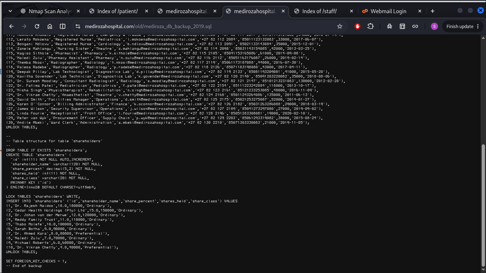

# NETWORKWALKS-Zaharan_Siaka-B083-WK4-MEDIROZA-PENETRATION-TESTING

# MEDIROZA GENERAL HOSPITAL – PENETRATION TESTING REPORT

**Project:** Networkwalks Penetration Testing Project  
**Client:** Mediroza General Hospital  
**Batch:** B083  
**Week:** 4  
**Testing Type:** Black-Box Penetration Testing  
**Target:** `https://medirozahospital.com`  
**Testing Duration:** 5 Days  

---

## 1. EXECUTIVE SUMMARY

This penetration testing exercise was conducted against Mediroza General Hospital's website as part of the Networkwalks Week 4 penetration testing project.

The objective was to assess the security of the authorised target, retrieve three confidential patient laboratory reports, test the encryption protecting the reports, and investigate the exposure of employee salary and shareholder information.

During the assessment, several security weaknesses were identified. These included an SQL injection vulnerability in the patient login process, unauthorised access to the patient portal, weak PDF password protection, and an exposed database backup directory.

The assessment demonstrated that these weaknesses could allow an attacker to access confidential information without legitimate authorisation.

The findings indicate that the website requires immediate security improvements, particularly in input handling, authentication, access control, file storage, and the protection of sensitive information.

---

## 2. SCOPE AND METHODOLOGY

### 2.1 Scope

The assessment was limited to the authorised target:

- **Website:** `https://medirozahospital.com`
- Patient login and portal functionality.
- Publicly accessible website directories and files.
- Three patient laboratory reports made available through the portal.
- Exposed database backup discovered during the assessment.

Testing was restricted to the authorised domain. Social engineering, denial-of-service testing, and testing outside the approved scope were not performed.

### 2.2 Methodology

The assessment followed a structured penetration testing process:

1. **Reconnaissance:** Collected information about the target domain, DNS records, web server, technologies, and available directories.
2. **Enumeration:** Examined accessible pages, login forms, directories, and application responses.
3. **Exploitation:** Tested the patient login functionality and confirmed an SQL injection-based authentication bypass.
4. **File Retrieval and Password Recovery:** Retrieved the three assigned PDF reports, extracted their password hashes, and tested their password protection.
5. **Further Investigation:** Examined the retrieved files and their metadata, then investigated the exposed database backup.
6. **Documentation:** Recorded the findings and supporting evidence for the final report.

### 2.3 Tools Used

| Tool | Purpose |
|---|---|
| WHOIS | Domain registration information |
| DIG | DNS record enumeration |
| Nmap | Port scanning and service detection |
| WhatWeb | Website technology identification |
| cURL | HTTP request and response inspection |
| Gobuster | Directory and file enumeration |
| Burp Suite | Intercepting and testing web requests |
| PDFInfo | Inspecting PDF document properties and encryption |
| QPDF | Examining PDF encryption |
| pdf2john | Extracting PDF password hashes |
| John the Ripper | Password recovery testing |
| ExifTool | Inspecting PDF metadata |
| Kali Linux | Testing environment |

### 2.4 Limitations

The assessment was limited to the target and activities authorised in the project instructions. No denial-of-service testing or social engineering was conducted.

---

## 3. FINDINGS AND PROOF OF EXPLOITATION

### 3.1 MILESTONE 1 – WEBSITE TESTING AND RETRIEVAL OF PATIENT REPORTS

#### 3.1.1 Reconnaissance

Initial reconnaissance was performed to identify the target's domain information, DNS records, web technologies, and exposed services.

The target resolved to the IP address `199.188.201.16`.

The web server responses and technology checks indicated the use of LiteSpeed and HAProxy.

Nmap identified ports 80 and 443 as open.

**Supporting evidence – Gobuster reconnaissance:**

#### 3.1.2 Directory Enumeration

Gobuster was used to identify directories and files accessible on the target website.

During enumeration, an `/old/` directory was identified. Further manual inspection confirmed that the directory exposed an old database backup file.

**Supporting evidence – Exposed old directory:**

#### 3.1.3 SQL Injection and Authentication Bypass

The patient login form was tested using controlled input values.

Different responses were observed when testing valid-looking, invalid, and modified usernames. The application returned a database syntax error when a single quote was supplied as part of the username.

A further SQL injection test using a comment sequence resulted in a redirect to the patient portal without valid patient credentials.

This confirmed an SQL injection-based authentication bypass.

The portal displayed three assigned laboratory reports.

**Supporting evidence:**

- `files/admin-login-response.txt`
- `files/sql-error-response.txt`
- `files/login-comparison.txt`
- `files/m1-patient-portal-access.txt`

#### 3.1.4 Retrieval of the Three Patient Reports

After accessing the patient portal, the following reports were identified and retrieved:

| Report | Patient Name | Laboratory Reference | Report Date |
|---|---|---|---|
| Patient Report 1 | S. Dlamini | LR-2024-1187 | 04 November 2024 |
| Patient Report 2 | P. Reddy | LR-2024-1192 | 05 November 2024 |
| Patient Report 3 | E. Thompson | LR-2024-1205 | 06 November 2024 |

All three PDF files were successfully downloaded.

The files were encrypted and required passwords before their contents could be accessed.

The retrieved PDFs are retained locally as assessment evidence and are not included in this public repository.

---

### 3.2 MILESTONE 2 – PDF ENCRYPTION AND PASSWORD RECOVERY

The three retrieved PDF reports were examined to determine whether their password protection could be bypassed through password recovery testing.

Initial inspection using PDFInfo and QPDF confirmed that the documents were encrypted and rejected access without the correct password.

#### 3.2.1 Password Hash Extraction and Recovery

For the first report, `pdf2john` was used locally to extract the PDF password hash. John the Ripper was then used with the available RockYou wordlist to perform password recovery.

For the second and third reports, an online PDF hash extraction service was used to obtain the hashes. The recovered hashes were then tested using Johnny/John the Ripper.

All three passwords were successfully recovered, and each original PDF was opened to verify access to its contents.

| Report | Hash Extraction Method | Password Recovery Method | Result |
|---|---|---|---|
| Report 1 | pdf2john | John the Ripper | Successful |
| Report 2 | Online hash extraction service | Johnny/John the Ripper | Successful |
| Report 3 | Online hash extraction service | Johnny/John the Ripper | Successful |

#### 3.2.2 Password Recovery Evidence

**First PDF report:**

**Second PDF report:**

**Third PDF report:**

The successful recovery of all three passwords demonstrated that the password protection used on the reports was insufficient to prevent access through password guessing.

**Security note:** The online hash extraction service was used only for the assigned exercise. Real patient documents or other confidential files should not be uploaded to third-party services without explicit approval.

---

### 3.3 MILESTONE 3 – DATABASE BACKUP INVESTIGATION

#### 3.3.1 Discovery of the Database Backup

Further investigation of the exposed `/old/` directory revealed a file named:

`mediroza_db_backup_2019.sql`

The file contained an SQL database backup associated with the hospital's internal database.

The backup included two important tables:

- `staff`
- `shareholders`

The staff table contained employee names, job titles, departments, contact information, national identification information, monthly salaries, and joining dates.

The shareholders table contained shareholder names, ownership percentages, number of shares held, and share classes.

The database backup was saved locally for analysis.

#### 3.3.2 PDF Metadata Investigation

ExifTool was used to inspect the metadata of the third retrieved PDF report.

The following metadata was identified:

| Metadata Field | Value |
|---|---|
| Author | j.malik |
| Creator | Mediroza CMS 1.4.2 |
| Producer | Mediroza Lab Reporting Module |
| Title | Pathology Report - E. Thompson |
| Subject | Full Blood Count |
| Keywords | pathology, patient report |
| Comments | DB backup moved to /old before site migration, do not delete |

The comments field contained a reference to the database backup being moved into the `/old/` directory.

This provided an important clue that helped direct further investigation towards the exposed backup directory.

The metadata value `j.malik` was recorded as an author field; it does not independently establish who created or moved the file.

**Supporting evidence – PDF metadata investigation:**

**Additional PDF investigation:**

#### 3.3.3 Employee Salary Information

The staff table contained 30 employee records.

The following table summarises the employee names, positions, departments, and monthly salaries recovered from the database backup.

| No. | Employee | Job Title | Department | Monthly Salary (ZAR) |
|---:|---|---|---|---:|
| 1 | Dr. Rajesh Naidoo | Chief Pathologist | Diagnostics Lab | R138,000 |
| 2 | Sarah Botha | Chief Financial Officer | Finance | R152,000 |
| 3 | Dr. Johan van der Merwe | Medical Director | Management | R160,000 |
| 4 | Dr. Anita Naicker | Consultant Cardiologist | Cardiology | R132,000 |
| 5 | Dr. Ahmed Kara | Consultant Physician | Internal Medicine | R128,000 |
| 6 | Dr. Yusuf Cassim | Senior Registrar | Emergency & Trauma | R74,000 |
| 7 | Michael Roberts | HR Director | Human Resources | R96,000 |
| 8 | Susan Pretorius | HR Officer | Human Resources | R32,000 |
| 9 | Jameel Malik | IT Systems Administrator | IT | R58,000 |
| 10 | Thabo Molefe | Network Engineer | IT | R46,000 |
| 11 | Nomvula Khumalo | Registered Nurse | Emergency & Trauma | R34,000 |
| 12 | Lerato Mokoena | Registered Nurse | Pediatrics | R33,000 |
| 13 | Bongani Ndlovu | Registered Nurse | Cardiology | R35,000 |
| 14 | Zanele Mahlangu | Nursing Sister | Theatre | R42,000 |
| 15 | Kagiso Sithole | Pharmacist | Pharmacy | R61,000 |
| 16 | Naledi Zulu | Pharmacy Assistant | Pharmacy | R26,000 |
| 17 | Themba Nkosi | Radiographer | Radiology | R44,000 |
| 18 | Palesa Radebe | Radiographer | Radiology | R43,000 |
| 19 | Deepak Pillay | Lab Technologist | Diagnostics Lab | R41,000 |
| 20 | Kavitha Govender | Lab Technician | Diagnostics Lab | R35,000 |
| 21 | Dr. Suresh Moodley | Consultant Radiologist | Radiology | R130,000 |
| 22 | Dr. Fatima Patel | Pediatrician | Pediatrics | R118,000 |
| 23 | Nisha Singh | Physiotherapist | Rehabilitation | R48,000 |
| 24 | Dr. Vikram Chetty | Anaesthetist | Theatre | R135,000 |
| 25 | David Smith | Facilities Manager | Operations | R52,000 |
| 26 | Karen O'Connor | Billing Administrator | Finance | R29,000 |
| 27 | James Wilson | Security Supervisor | Operations | R27,000 |
| 28 | Linda Fourie | Receptionist | Front Office | R19,000 |
| 29 | Peter van Wyk | Procurement Officer | Supply Chain | R38,000 |
| 30 | Andile Mbeki | Ward Clerk | Administration | R21,000 |

**Key finding:** The highest monthly salary identified was R160,000, belonging to Dr. Johan van der Merwe, the Medical Director.

#### 3.3.4 Shareholder Information

The shareholders table contained 10 records.

| No. | Shareholder | Ownership | Shares Held | Share Class |
|---:|---|---:|---:|---|
| 1 | Dr. Rajesh Naidoo | 18% | 180,000 | Ordinary |
| 2 | Cedar Health Holdings (Pty) Ltd | 15% | 150,000 | Ordinary |
| 3 | Dr. Johan van der Merwe | 12% | 120,000 | Ordinary |
| 4 | Reddy Family Trust | 11% | 110,000 | Ordinary |
| 5 | Thabo Molefe | 10% | 100,000 | Ordinary |
| 6 | Sarah Botha | 9% | 90,000 | Ordinary |
| 7 | Dr. Ahmed Kara | 8% | 80,000 | Preferential |
| 8 | Naledi Zulu | 7% | 70,000 | Ordinary |
| 9 | Michael Roberts | 6% | 60,000 | Ordinary |
| 10 | Dr. Vikram Chetty | 4% | 40,000 | Preferential |

**Key finding:** The largest individual shareholder identified was Dr. Rajesh Naidoo, with an ownership stake of 18%.

The shareholder percentages totalled 100%.

**Supporting evidence – Shareholder information:**

#### 3.3.5 Impact of the Exposed Database

The exposed database backup represented a serious information disclosure risk.

An unauthorised person with access to the backup could obtain employee salary information, shareholder details, and other confidential records.

The exposed information could potentially be misused for identity theft, social engineering, targeted phishing, financial fraud, or other attacks against the organisation and its employees.

The exposure of the backup also demonstrated inadequate protection of sensitive files stored on the web server.

---

## 4. RISK RATING

The following risk ratings were assigned based on the potential impact and the evidence obtained during the assessment.

| Finding | Risk Rating | Justification |
|---|---|---|
| SQL injection and patient portal authentication bypass | Critical | Allowed access to the patient portal without valid credentials and exposed confidential patient reports. |
| Exposed database backup in `/old/` | Critical | Exposed employee salary information, shareholder details, and other confidential records. |
| Weak PDF password protection | High | All three encrypted reports had passwords successfully recovered through password recovery testing. |
| Database error disclosure | Medium | The application returned raw database error information when supplied with modified input. |
| Username enumeration | Low | Different responses helped distinguish an existing username from an invalid username. |

These ratings are based on the demonstrated impact and observed behaviour during the authorised assessment. They are qualitative risk ratings rather than formal CVSS scores.

---

## 5. RECOMMENDATIONS AND REMEDIATION

### 5.1 Prevent SQL Injection

- Use parameterised queries or prepared statements for all database operations.
- Avoid directly inserting user-supplied input into SQL statements.
- Validate and sanitise user input on the server side.
- Conduct regular secure code reviews and application security testing.

### 5.2 Improve Authentication and Access Control

- Ensure that authentication cannot be bypassed through manipulated input.
- Implement secure session management.
- Enforce proper authorisation checks on all patient portal pages and report downloads.
- Use generic login error messages to reduce username enumeration.
- Apply appropriate account lockout or rate-limiting controls.

### 5.3 Secure Sensitive Files and Database Backups

- Remove database backups and old application files from publicly accessible web directories.
- Store backups outside the web root.
- Restrict access to backup files using appropriate permissions.
- Encrypt backups and protect them with strong access controls.
- Regularly review the server for forgotten files and exposed directories.

### 5.4 Strengthen PDF Password Protection

- Use strong, unique passwords for sensitive PDF documents.
- Avoid predictable passwords and weak password patterns.
- Apply appropriate encryption and access controls.
- Avoid relying on PDF passwords as the only protection for confidential documents.
- Store and transmit sensitive reports through secure, authenticated systems.

### 5.5 Prevent Information Disclosure

- Disable detailed database error messages in production.
- Log technical errors securely on the server.
- Return generic error messages to users.
- Review application responses to ensure they do not reveal internal implementation details.

### 5.6 Protect Employee and Shareholder Information

- Restrict access to HR and shareholder records to authorised personnel.
- Apply the principle of least privilege.
- Encrypt sensitive records at rest and during transmission.
- Review access permissions regularly.
- Establish secure procedures for handling and disposing of database backups.

### 5.7 General Security Improvements

- Keep the CMS, server software, and application dependencies updated.
- Perform regular vulnerability assessments and penetration tests.
- Monitor server logs for suspicious login attempts and unusual file access.
- Maintain secure backup and recovery procedures.
- Conduct periodic reviews of the website's public directories and exposed resources.

---

## CONCLUSION

The assessment successfully completed the three assigned milestones.

The first milestone demonstrated that the patient login functionality was vulnerable to SQL injection, allowing access to the patient portal and retrieval of the three assigned laboratory reports.

The second milestone demonstrated that all three encrypted PDF reports had passwords that could be recovered through password recovery testing, allowing their contents to be accessed.

The third milestone identified an exposed database backup containing employee salary and shareholder information. Further investigation of PDF metadata also revealed a comment that pointed towards the `/old/` directory.

The findings demonstrate the importance of secure input handling, strong authentication, proper access control, secure file storage, and effective protection of confidential information.

Addressing the identified weaknesses would significantly improve the security of Mediroza General Hospital's website and reduce the risk of unauthorised access to sensitive information.

---

**END OF REPORT**
